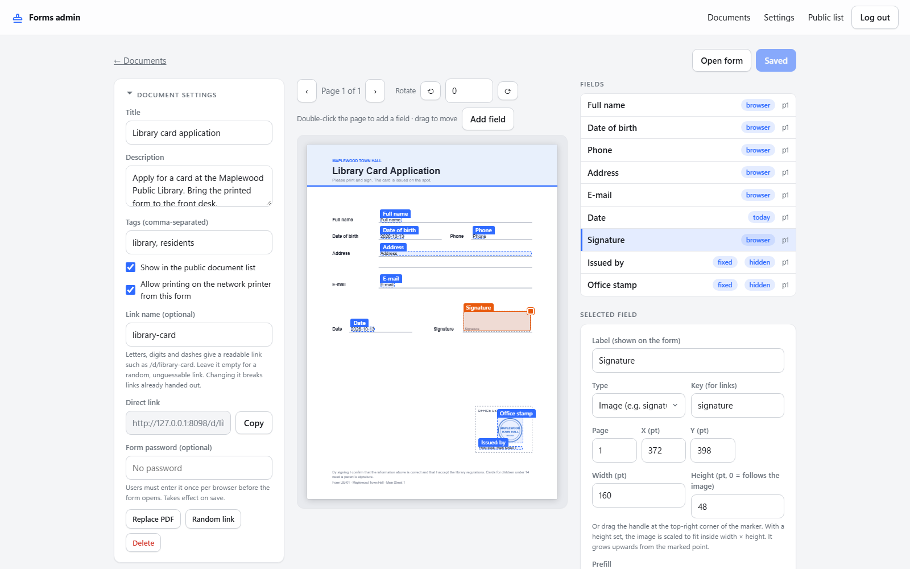
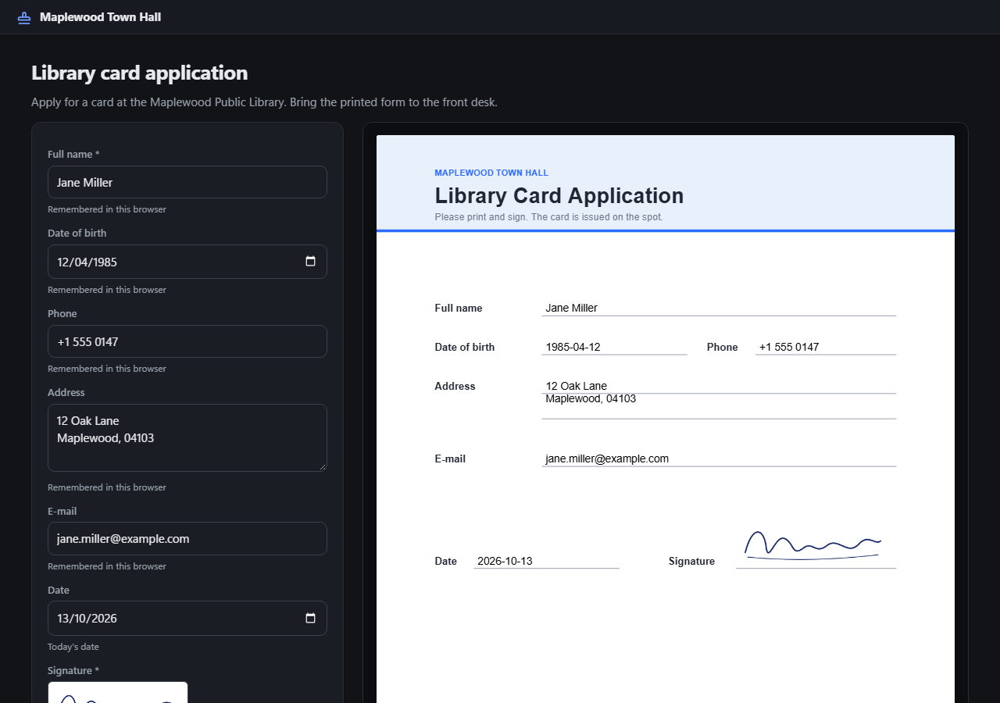
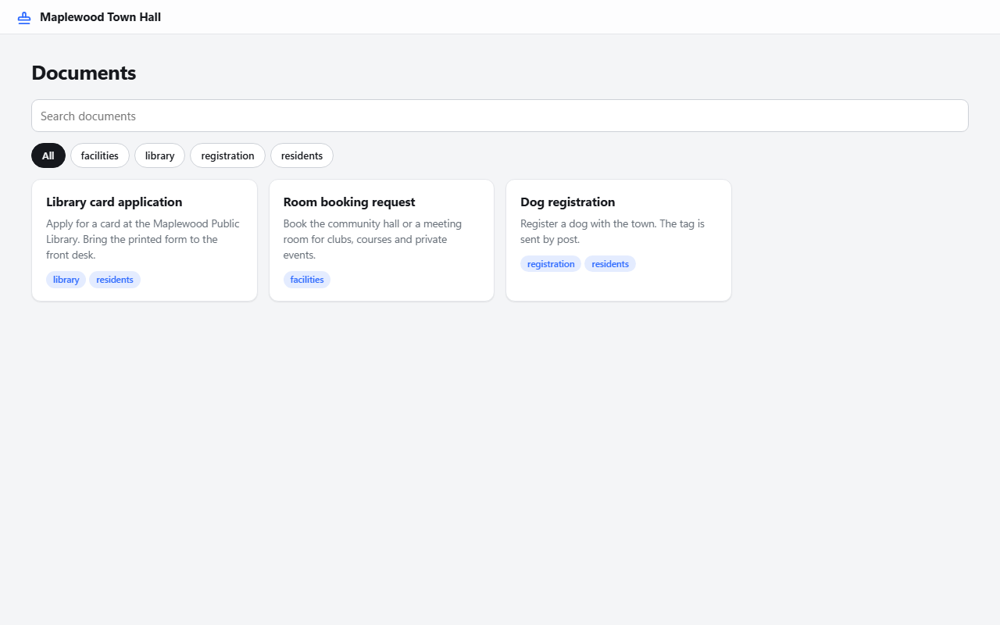
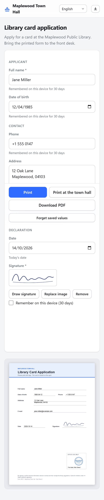

# stampfill

Stamp text onto PDF templates from a web form, then print or download the result.

You have a paper form as a PDF. People keep filling it in by hand, or they open it in a PDF
editor and fight with the layout. stampfill gives each template a web page: pick the fields once
in the admin interface, share the link, and everyone gets a form with a live preview, a Print
button, a download, and optionally a "Send to printer" button that prints on a network printer
straight from the server.

The whole service is one file (`stampfill.js`) with two runtime dependencies. No database, no
build step. It is meant for a school office, a club, a small company, a household.

[](https://github.com/PhilippMundhenk/stampfill/actions/workflows/ci.yml)
[](LICENSE)


| The editor: place and size fields on the template | Dark mode |
| --- | --- |
|  |  |
| Public index with tags and search | On a phone |
|  |  |

The screenshots come from a demo instance that `npm run screenshots` builds from scratch.

## Features

- **Field editor**: double-click on the rendered page to add a field, drag to move it. Text,
  multi-line text, date (four formats) and checkbox fields. Wrap width, font size, required flag.
- **Straighten and rotate**: each page of the template can be rotated by quarter turns or by
  single degrees (for skewed scans). The upload stays untouched; the angle is applied on render.
- **Prefill** per field: remembered in the user's browser, fixed for this instance, carried in
  the link (`/d/<link>#key=value`), or today's date for date fields. Users get a "Copy link with
  values" button.
- **Signatures and images**: a signature field opens a drawing pad (touch or mouse) or takes an
  uploaded picture; an image field takes a PNG or JPEG. Pictures are scaled down in the browser
  and stamped into the field's box. With browser prefill each user picks their signature once and the
  browser remembers it; the admin can also upload a default image (a stamp, a logo) that users may
  replace. Default images live in `DATA_DIR/images`.
- **Fixed text**: blocks the admin writes once (a footer note, an office address) that are printed
  on every copy and never shown to users as an input.
- **Printing**: browser print (vector PDF on desktop Chromium, high-resolution page images
  everywhere else), PDF download, and server-side printing through IPP (CUPS or any printer
  that accepts PDF). The server-print button is called "Print at home" by default, can be renamed
  in Settings, and can be switched off per document.
- **Sharing**: documents get an unguessable random link; set a link name in the editor for a
  readable one (`/d/library-card-request`). Documents can be listed on the public index with tags
  and search, and can require a password before they open.
- **Hidden fields**: any field can be hidden on the form while still being printed. Fields with a
  fixed value are hidden by default.
- **Order and groups**: fields appear on the form in the order of the editor's list, which can be
  rearranged by drag-and-drop or with arrow buttons; a group name turns into a heading on the form.
- **Unicode**: drop a TrueType font at `DATA_DIR/font.ttf` and all stamped text uses it.
- **Small footprint**: single process, JSON file plus the uploaded PDFs on disk, around 50 MB
  resident memory. Pages and assets are served gzip-compressed from memory.
- **Light and dark**: follows the system colour scheme, works on phones, respects reduced motion.
- **Languages**: English, German, Turkish, Arabic (right-to-left), Russian, Ukrainian, Greek and
  Polish. The pages follow the browser language, a switcher in the header remembers a choice, and
  Settings has an instance default. Stamped text in Greek, Cyrillic or accented Latin letters uses
  a bundled TrueType font; Arabic and other scripts need a font at `DATA_DIR/font.ttf` (see below).

## Quick start

### Docker Compose (recommended)

```sh
git clone https://github.com/PhilippMundhenk/stampfill.git
cd stampfill
cp .env.example .env          # set ADMIN_PASSWORD
docker compose up -d
```

Open <http://localhost:8080/admin>, log in, upload a PDF.

### Docker without Compose

```sh
docker run -d --name stampfill -p 8080:8080 -v stampfill-data:/data \
  -e ADMIN_PASSWORD=change-me ghcr.io/philippmundhenk/stampfill:latest
```

### Node.js

```sh
npm ci --omit=dev
ADMIN_PASSWORD=change-me node stampfill.js
```

Needs Node.js 22 or newer. If `ADMIN_PASSWORD` is not set, a random password is generated on
first start, printed to the log once, and can be changed in the admin settings.

### Translations

Translations live in `locales/<language>.json` as a flat map from the English source string to
the translation; a missing key shows the English text. They were produced with machine help and
reviewed lightly, so corrections are welcome: edit the file and open a pull request. A unit test
fails when a locale misses a string the pages use.

## Configuration

Everything is configured through environment variables.

| Variable | Default | Purpose |
| --- | --- | --- |
| `ADMIN_PASSWORD` | generated | Admin password. When set, it cannot be changed in the UI. |
| `PORT` | `8080` | Listen port |
| `HOST` | `0.0.0.0` | Listen address |
| `DATA_DIR` | `./data` (`/data` in Docker) | Holds `db.json`, uploaded PDFs and the optional `font.ttf` |
| `TRUST_PROXY` | unset | `1` only behind a reverse proxy you control: the client address is then the last `X-Forwarded-For` entry and `X-Forwarded-Proto` decides the `Secure` cookie flag |
| `SECURE_COOKIES` | unset | `1` forces the `Secure` flag on cookies when HTTPS is terminated by a proxy that does not send `X-Forwarded-Proto` |
| `ADMIN_PASSWORD_FILE` | unset | Read the admin password from this file instead of `ADMIN_PASSWORD` (Docker secrets) |
| `MAX_PDF_MB` | `25` | Upload limit for templates |

Runtime settings (site title, printer URL, public printing) live in the admin interface under
Settings.

## Deployment

### Printing through CUPS

See "Printers that do not accept PDF" above: `docker-compose.cups.yml` adds a CUPS server with
its own volume; printers are registered once with `lpadmin` and survive restarts.

### HTTPS with Caddy

Set `DOMAIN` in `.env` to a hostname that resolves to the server and start with the overlay:

```sh
docker compose -f docker-compose.yml -f docker-compose.caddy.yml up -d
```

Caddy obtains and renews a Let's Encrypt certificate and proxies to stampfill. Port 8080 is no
longer published.

### File permissions (UID/GID)

The container runs as the unprivileged user `node`, **UID 1000 and GID 1000**, and writes only to
`/data`. Errors like `EACCES: permission denied, open '/data/db.json'` mean that directory is
owned by someone else. Two ways to fix it:

- **Named volume** (the default in `docker-compose.yml`): nothing to do. Docker creates the volume
  with the ownership baked into the image.
- **Bind mount** (`./data:/data`): either give the host folder to UID 1000
  (`sudo chown -R 1000:1000 ./data`), or run the container as the folder's owner. Find your ids
  with `id -u` and `id -g`, put them into `.env` as `PUID` and `PGID`, and Compose passes them
  as `user: "PUID:PGID"`. Without Compose: `docker run --user 1000:1000 …`.

The service refuses to start, with a message naming the UID/GID it runs as, when `/data` is not
writable, so a wrong setting shows up in `docker compose logs` right away.

### Behind your own reverse proxy

Point nginx, Traefik or similar at port 8080, forward `X-Forwarded-For` and
`X-Forwarded-Proto`, set `TRUST_PROXY=1` and `BIND=127.0.0.1` in `.env`. The client address is
taken from the last `X-Forwarded-For` entry, the one your proxy appends. The session cookie is
marked `Secure` when `X-Forwarded-Proto` says `https` (or always, with `SECURE_COOKIES=1`), and
the app then also sends HSTS.

### Printing from the server

Enter the printer's IPP URL in Settings. The printer (or CUPS queue) must accept PDF.

| Target | URL |
| --- | --- |
| CUPS queue | `http://cups-host:631/printers/Office` |
| Printer with IPP Everywhere / AirPrint (most Brother, HP, Canon, Epson models), e.g. a Brother MFC-L2700DW | `ipp://192.168.1.50:631/ipp/print` |

Keep the `:631` port in the URL and use the printer's IP address rather than its `.local` name:
mDNS usually does not resolve inside a container, and a DHCP reservation keeps the address stable.
"Test printer" in Settings asks the printer what it is and which document formats it accepts.

#### Printers that do not accept PDF (IPP status 0x040a)

Many home and small-office printers, the Brother MFC-L2700DW among them, only take raster formats
over IPP and answer a PDF job with `0x040a` (document format not supported). CUPS converts the
PDF for them. The repository ships a CUPS sidecar:

```sh
docker compose -f docker-compose.yml -f docker-compose.cups.yml up -d
# register the printer once, driverless ("IPP Everywhere"), by IP address:
docker compose exec cups lpadmin -p Office -E -v ipp://192.168.1.50/ipp/print -m everywhere
```

Then enter `http://cups:631/printers/Office` as the printer URL in Settings and press "Test
printer": a CUPS queue always accepts PDF. The sidecar is not reachable from the network on
purpose, since whoever controls the queue receives every printed form; administer it with
`docker compose exec cups lpadmin ...` (the overlay file explains how to reach the web interface
through an SSH tunnel if you need it). `CUPSPASSWORD` must be set in `.env`. Without Docker, any
CUPS server on the network works the same way: point stampfill at
`http://cups-host:631/printers/<queue>`, preferably over `ipps://` where available.

Other IPP status codes are explained in the error message; the most common besides 0x040a are
`0x0406` (wrong path in the printer URL) and `0x0506` (the printer is not accepting jobs). By default only a
logged-in admin sees the server-print button; the setting "Let everyone with a document link use
this printer" opens it to all users, which only makes sense on a trusted network. The button's
label is a setting ("Print at home" by default), and each document can disable it.

### Backups and upgrades

All state is in the data volume (`stampfill-data` in Compose, `DATA_DIR` otherwise):
`db.json` with the documents, field layouts, settings, admin password hash and session secret,
the `pdfs/` and `images/` folders, `audit.log` (logins, settings changes, document changes and
print jobs, never form values; rotate it with the host's tools) and the optional `font.ttf`.
Nothing else is kept on the server, so backing up that directory is a complete backup. It also
holds the signing secret and password hashes, so treat backups as secrets. Browser-remembered
field values live in each user's browser only, for 30 days. Upgrading is `docker compose pull && docker compose up -d`. The `db.json` format
is forward compatible; missing settings get their defaults.

### Without Docker

Node.js 22+, a writable data directory and a reverse proxy are all it takes. [docs/deploy-without-docker.md](docs/deploy-without-docker.md)
walks through Uberspace (supervisord service plus web backend) and a generic systemd unit with
hardening (`deploy/systemd/`).

### Health check

`GET /healthz` returns `{"ok":true,"version":"…","docs":N}`. The Docker image and the Compose
file already use it.

## Pages and API

| Path | What |
| --- | --- |
| `/` | Public index of listed documents, filterable by tag |
| `/d/<link>` | Form for one document: fill, preview, print, download |
| `/admin` | Admin interface |
| `/healthz` | Liveness probe |
| `/api/docs`, `/api/d/<link>`, `/api/d/<link>/render`, `/api/d/<link>/print`, `/api/d/<link>/unlock` | Public JSON API used by the form |
| `/api/login`, `/api/logout`, `/api/admin/...` | Admin API (session cookie) |

Mutating requests must carry the header `X-Requested-With: stampfill`, which is the CSRF guard.

## Development

```sh
npm ci
npx playwright install chromium
npm run lint         # ESLint
npm run test:unit    # helpers, HTTP API, upgrade path and process behaviour (node:test under c8)
npm run test:e2e     # browser tests, Playwright
npm test             # all of the above
```

Coverage is enforced: at least 95% of the server lines (c8, `.c8rc.json`) and 85% of each inline
page script, measured through Chromium's V8 coverage by the browser suite itself. Both runs print
their numbers; details in [CONTRIBUTING.md](CONTRIBUTING.md).

The end-to-end suite boots a fresh instance on port 8099 and a mock IPP printer on port 6310,
then walks through login, upload, field placement, settings, the public form, server print,
download, link sharing, the mobile layout and document deletion. See
[CONTRIBUTING.md](CONTRIBUTING.md).

`n8n/` holds an earlier n8n workflow that does a fixed version of the same job without the web
UI; it is kept for reference.

## Design and security

[docs/design.md](docs/design.md) explains how the service is built; the decisions behind it are
recorded in [docs/adr/](docs/adr/README.md). The security review lives in
[docs/security.md](docs/security.md).

## License

[MIT](LICENSE)
