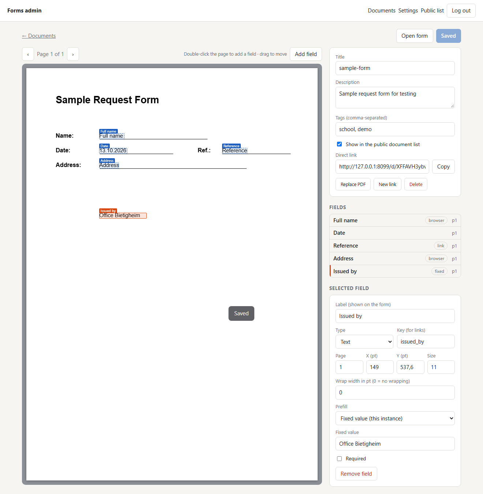
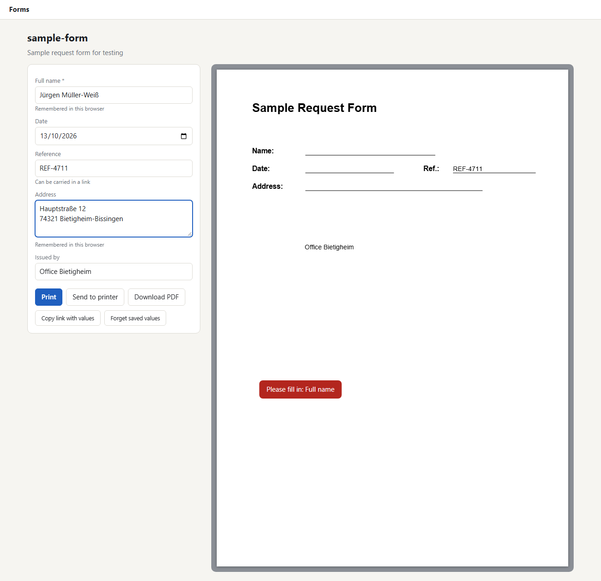

# stampfill

Stamp text onto PDF templates from a web form, then print or download the result.

You have a paper form as a PDF. People keep filling it in by hand, or they open it in a PDF
editor and fight with the layout. stampfill gives each template a web page: pick the fields once
in the admin interface, share the link, and everyone gets a form with a live preview, a Print
button, a download, and optionally a "Send to printer" button that prints on a network printer
straight from the server.

The whole service is one file (`stampfill.js`) with two runtime dependencies. No database, no
build step. It is meant for a school office, a club, a small company, a household.

[](https://github.com/PhilippMundhenk/stampfill/actions/workflows/ci.yml)
[](LICENSE)

| Admin: place fields on the template | Public form with live preview |
| --- | --- |
|  |  |

## Features

- **Field editor**: double-click on the rendered page to add a field, drag to move it. Text,
  multi-line text, date (four formats) and checkbox fields. Wrap width, font size, required flag.
- **Prefill** per field: remembered in the user's browser, fixed for this instance, or carried in
  the link (`/d/<link>#key=value`). Users get a "Copy link with values" button.
- **Printing**: browser print (vector PDF on desktop Chromium, high-resolution page images
  everywhere else), PDF download, and server-side printing through IPP (CUPS or any printer
  that accepts PDF).
- **Sharing**: documents are reachable by an unguessable link, optionally listed on the public
  index with tags and search. Links can be rotated.
- **Unicode**: drop a TrueType font at `DATA_DIR/font.ttf` and all stamped text uses it.
- **Small footprint**: single process, JSON file plus the uploaded PDFs on disk, around 50 MB
  resident memory.

## Quick start

### Docker Compose (recommended)

```sh
git clone https://github.com/PhilippMundhenk/stampfill.git
cd stampfill
cp .env.example .env          # set ADMIN_PASSWORD
docker compose up -d
```

Open <http://localhost:8080/admin>, log in, upload a PDF.

### Docker without Compose

```sh
docker run -d --name stampfill -p 8080:8080 -v stampfill-data:/data \
  -e ADMIN_PASSWORD=change-me ghcr.io/philippmundhenk/stampfill:latest
```

### Node.js

```sh
npm ci --omit=dev
ADMIN_PASSWORD=change-me node stampfill.js
```

Needs Node.js 22 or newer. If `ADMIN_PASSWORD` is not set, a random password is generated on
first start, printed to the log once, and can be changed in the admin settings.

## Configuration

Everything is configured through environment variables.

| Variable | Default | Purpose |
| --- | --- | --- |
| `ADMIN_PASSWORD` | generated | Admin password. When set, it cannot be changed in the UI. |
| `PORT` | `8080` | Listen port |
| `HOST` | `0.0.0.0` | Listen address |
| `DATA_DIR` | `./data` (`/data` in Docker) | Holds `db.json`, uploaded PDFs and the optional `font.ttf` |
| `TRUST_PROXY` | unset | Set to `1` behind a reverse proxy so the login rate limit sees real client IPs |
| `MAX_PDF_MB` | `25` | Upload limit for templates |

Runtime settings (site title, printer URL, public printing) live in the admin interface under
Settings.

## Deployment

### HTTPS with Caddy

Set `DOMAIN` in `.env` to a hostname that resolves to the server and start with the overlay:

```sh
docker compose -f docker-compose.yml -f docker-compose.caddy.yml up -d
```

Caddy obtains and renews a Let's Encrypt certificate and proxies to stampfill. Port 8080 is no
longer published.

### Behind your own reverse proxy

Point nginx, Traefik or similar at port 8080, forward `X-Forwarded-For` and
`X-Forwarded-Proto`, and keep `TRUST_PROXY=1`. The session cookie is marked `Secure` only when
`X-Forwarded-Proto` says `https`.

### Printing from the server

Enter the printer's IPP URL in Settings, for example `http://cups-host:631/printers/Office` or
`ipp://printer.local/ipp/print`. The printer (or CUPS queue) must accept PDF. By default only a
logged-in admin sees "Send to printer"; the setting "Let everyone with a document link use this
printer" opens it to all users, which only makes sense on a trusted network.

### Backups and upgrades

All state is in the data volume (`stampfill-data` in Compose, `DATA_DIR` otherwise). Back up
that directory. Upgrading is `docker compose pull && docker compose up -d`. The `db.json` format
is forward compatible; missing settings get their defaults.

### Health check

`GET /healthz` returns `{"ok":true,"version":"…","docs":N}`. The Docker image and the Compose
file already use it.

## Pages and API

| Path | What |
| --- | --- |
| `/` | Public index of listed documents, filterable by tag |
| `/d/<link>` | Form for one document: fill, preview, print, download |
| `/admin` | Admin interface |
| `/healthz` | Liveness probe |
| `/api/docs`, `/api/d/<link>`, `/api/d/<link>/render`, `/api/d/<link>/print` | Public JSON API used by the form |
| `/api/login`, `/api/logout`, `/api/admin/...` | Admin API (session cookie) |

Mutating requests must carry the header `X-Requested-With: stampfill`, which is the CSRF guard.

## Development

```sh
npm ci
npx playwright install chromium
npm run lint         # ESLint
npm run test:unit    # helpers and HTTP API, node:test
npm run test:e2e     # browser tests, Playwright
npm test             # all of the above
```

The end-to-end suite boots a fresh instance on port 8099 and a mock IPP printer on port 6310,
then walks through login, upload, field placement, settings, the public form, server print,
download, link sharing, the mobile layout and document deletion. See
[CONTRIBUTING.md](CONTRIBUTING.md).

`n8n/` holds an earlier n8n workflow that does a fixed version of the same job without the web
UI; it is kept for reference.

## License

[MIT](LICENSE)
