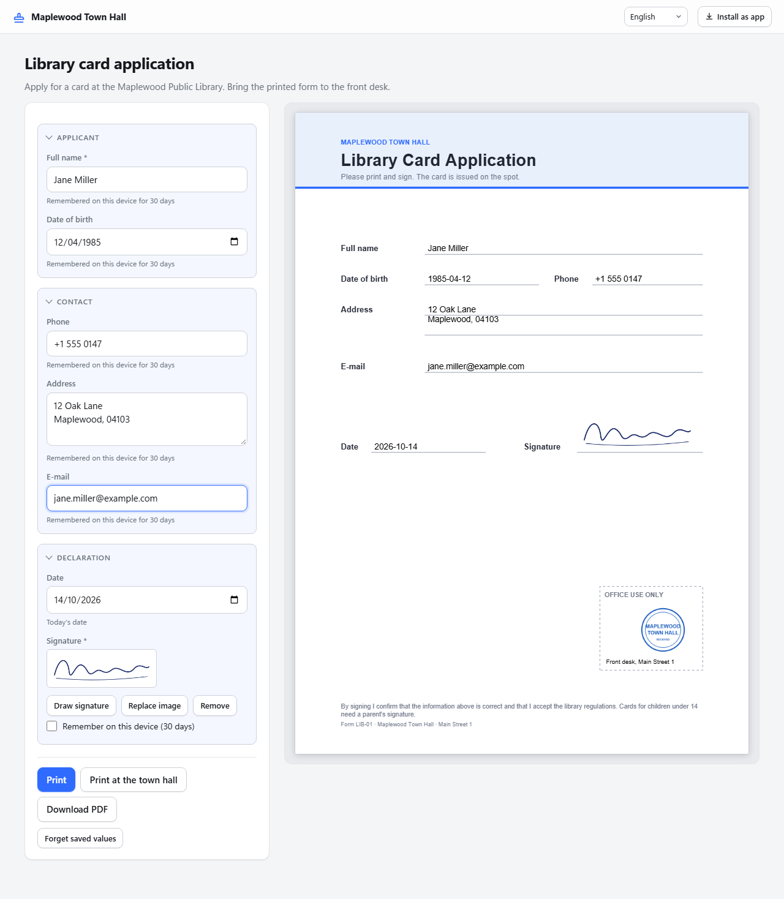

# stampfill

Turn any PDF form into a web page: place the fields once, share the link, and people fill it in
with a live preview, then print or download the finished PDF.

[](https://github.com/PhilippMundhenk/stampfill/actions/workflows/ci.yml)
[](LICENSE)



The whole service is one file, `stampfill.js`, with two runtime dependencies. No database, no
build step, around 50 MB of memory. It is meant for a school office, a club, a small company or a
household. [More screenshots](docs/screenshots.md).

## Features

- **Visual editor**: double-click on the rendered page to add a field, drag to move or resize it.
  Text, multi-line text, date, checkbox, image, signature (drawing pad or upload) and fixed text.
- **Prefill**: a field can be remembered in the visitor's browser, fixed by the admin, carried in
  the link (`/d/<link>#key=value`), or default to today's date.
- **Groups and order**: fields appear in the order of the editor's list. A group name becomes a
  heading on the form; groups are framed blocks that fold, move as units and can start closed.
- **Printing**: browser print, PDF download, and server-side printing to any IPP printer or CUPS
  queue with a button the admin can rename and switch off per form.
- **Sharing**: unguessable random links by default, readable link names on request, an optional
  public index with tags and search, and a password per form.
- **Install as an app**: every form is a progressive web app of its own. The install button in the
  header puts it on the home screen or desktop, and it opens exactly that form.
- **Templates stay intact**: pages can be rotated by quarter turns or single degrees to straighten
  a scan; the uploaded PDF is never modified.
- **Eight languages**: English, German, Turkish, Arabic (right-to-left), Russian, Ukrainian, Greek
  and Polish, following the browser with a switcher in the header.
- **Light and dark**, phone-friendly, hardened by default: see [docs/security.md](docs/security.md).

## Quick start

```sh
git clone https://github.com/PhilippMundhenk/stampfill.git
cd stampfill
cp .env.example .env          # set ADMIN_PASSWORD
docker compose up -d
```

Open <http://localhost:8080/admin>, log in and upload a PDF. Without Compose:

```sh
docker run -d --name stampfill -p 8080:8080 -v stampfill-data:/data \
  -e ADMIN_PASSWORD=change-me ghcr.io/philippmundhenk/stampfill:latest
```

Without Docker, Node.js 22 or newer is enough: `npm ci --omit=dev` and
`ADMIN_PASSWORD=change-me node stampfill.js`. See [docs/deploy-without-docker.md](docs/deploy-without-docker.md)
for Uberspace and systemd.

If `ADMIN_PASSWORD` is not set, a random password is generated on first start, printed to the
log once, and can be changed in Settings.

## Configuration

| Variable | Default | Purpose |
| --- | --- | --- |
| `ADMIN_PASSWORD` | generated | Admin password. When set, it cannot be changed in the UI. |
| `ADMIN_PASSWORD_FILE` | unset | Read the admin password from a file instead (Docker secrets) |
| `PORT`, `HOST` | `8080`, `0.0.0.0` | Listen port and address |
| `DATA_DIR` | `./data` (`/data` in Docker) | `db.json`, uploaded PDFs, images, `audit.log` and the optional `font.ttf` |
| `TRUST_PROXY` | `0` | `1` only behind a reverse proxy you control (client address and HTTPS detection from `X-Forwarded-*`) |
| `SECURE_COOKIES` | `0` | `1` forces the `Secure` cookie flag when the proxy does not send `X-Forwarded-Proto` |
| `MAX_PDF_MB` | `25` | Upload limit for templates |

Everything else (site title, printer, print button label, default language) is set in the admin
interface under Settings. All state lives in the data directory; backing it up is a complete
backup.

## Printing and deployment

- [docs/printing.md](docs/printing.md): printer URLs, the CUPS sidecar for printers that do not
  accept PDF (IPP status 0x040a), and what the other IPP status codes mean.
- [docs/deploy.md](docs/deploy.md): HTTPS with the Caddy overlay, running behind your own reverse
  proxy, file permissions for bind mounts (UID/GID), backups, upgrades and the health check.
- [docs/deploy-without-docker.md](docs/deploy-without-docker.md): Uberspace and systemd.

## Development

```sh
npm ci && npx playwright install chromium
npm test             # lint, unit and API tests under c8, browser tests with Playwright
```

Coverage is enforced at 95% of the server lines and 85% of each inline page script. The browser
suite boots a fresh instance with a mock IPP printer and walks through the whole story, from login
to deletion. [CONTRIBUTING.md](CONTRIBUTING.md) has the details, including how translations in
`locales/` are checked and how the screenshots are generated.

## Documentation

- [docs/design.md](docs/design.md): how the service is built, and the
  [architecture decision records](docs/adr/README.md) behind it.
- [docs/security.md](docs/security.md): threat model and the security reviews.
- [CHANGELOG.md](CHANGELOG.md): what changed in each release.

## License

[MIT](LICENSE)
