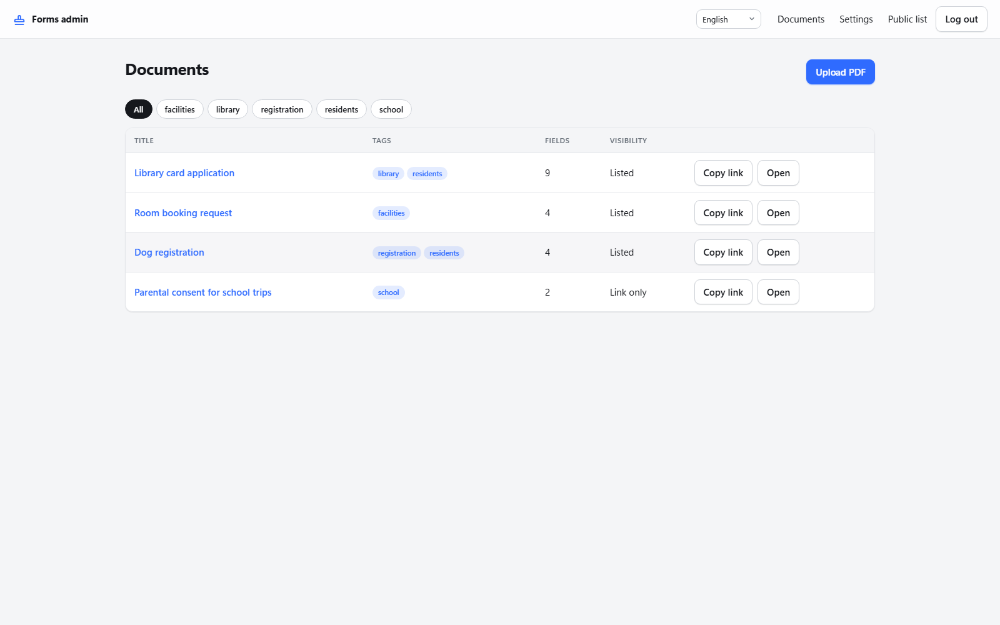

# Screenshots

All pictures come from a demo instance ("Maplewood Town Hall") that `npm run screenshots` builds
from scratch with `scripts/screenshots.js`.

## The public form

Fill in, watch the live preview, then print or download. The install button in the header turns
the form into an app on the home screen or desktop.

## The editor

Double-click on the page to place a field, drag to move or resize it. The list on the right is
the order on the form; groups become headings and move as blocks.

## Documents

The admin's list of documents with their links and tags.

## Public index

Listed documents with tags and search. Unlisted documents are reachable by link only.

## Dark mode and phones

| Dark colour scheme | On a phone |
| --- | --- |
|  |  |
